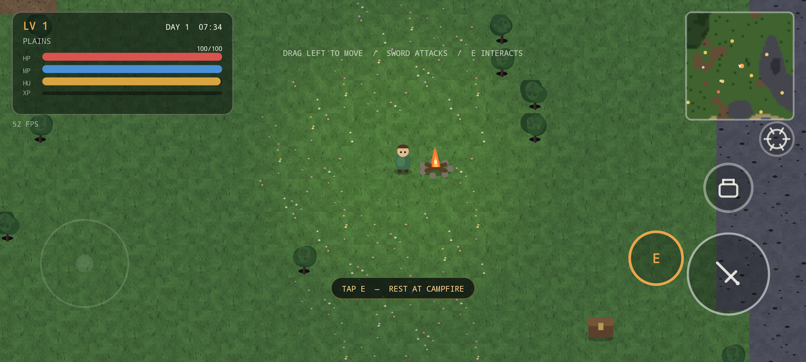
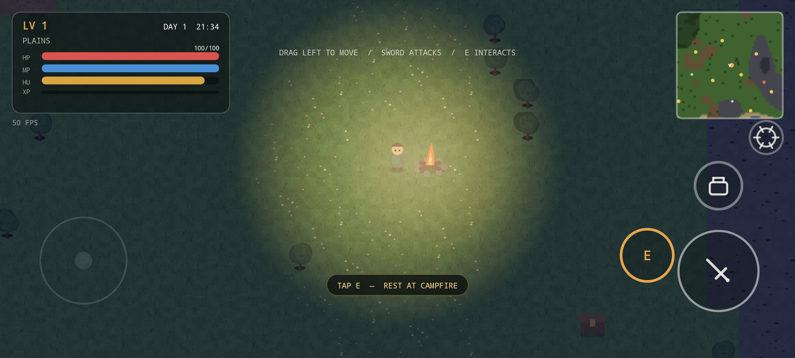

# Emberfall

A lightweight 2D open-world survival RPG for Android, built with
**Kotlin, Android Canvas / SurfaceView, and an optional C++/Vulkan renderer** — no heavy game engines or third-party framework dependencies.

Emberfall features infinite procedurally-generated biomes, real-time survival mechanics, gathering, weapon crafting, weapon upgrades, alchemy potions, spellcasting, shop economy, telegraphed boss encounters, downloadable content packs (DLC pipeline), and dynamic biome atmosphere.

<p>
  
  
</p>

*Captured on an Android 15 (API 35) emulator. The debug APK is ~3.5 MB including texture atlases and music.*

---

## What is Implemented

| System | Status |
| --- | --- |
| **Open World** | Infinite seeded chunks (forest, plains, highlands, shore, ocean, ruins, snow, volcanic, desert), streamed and evicted seamlessly |
| **Movement & Controls** | Dual analog touch joystick, sprint at full tilt, circle-vs-tile collision sliding |
| **Survival Vitals** | Health, mana, hunger, starvation ticks, campfire respawning & state persistence |
| **Items & Inventory** | 19 item types across 4 categories (materials, consumables, weapons, valuables) with 36 stackable inventory slots |
| **Combat & Aiming** | Auto-aiming melee and ranged attacks snapping to nearest target; 4 distinct weapon attack styles |
| **Weapon Upgrades** | Rank 1–4 upgrade paths per weapon boosting base attack damage via crafting materials |
| **Alchemy & Potions** | Health/mana restoration, +25% attack power potions, and health regeneration potions |
| **Gathering & Crafting** | Resource harvest nodes (trees, rocks, fruit) with 11 crafting recipes for weapons, food, and potions |
| **Magic Spells** | Fireball, Ice Freeze, Water Tsunami, Wind Tornado; high impact spellcasting consuming mana |
| **Wildlife & AI** | Rabbits, deer, boars, and wolves; wandering, fleeing, and aggressive pack behaviors |
| **Boss Encounters** | 5 named bosses in sealed arenas with unique intro lines, defeat signatures, telegraphs, and permanent stat boosts |
| **Shop Economy** | Gold from creatures/chests, Diamonds from bosses; full buy/sell market catalog in options |
| **Map & Minimap** | Real-time minimap with full-screen region map, fog of war, and campfire fast travel |
| **Rendering Engine** | Dual renderer support: Android Hardware Canvas (with AGSL shaders) & Native C++/Vulkan (`libemberfall_vk`) |
| **Isometric Engine** | Optional isometric projection system (`IsoMath`, `IsoAutotile`, `IsoAnimation`) alongside standard top-down view |
| **Game Feel & Juice** | Screen shake, hitstop freeze frames, and world-anchored floating combat text (`JuiceManager`) |
| **Atmosphere & Particles** | Per-biome fog tinting, wind strength, and ambient particle drift (embers, pollen, sea spray, leaves, dust) |
| **DLC / Content Pipeline**| Secure HTTPS downloadable content packs with JSON manifests, SHA-256 asset validation, and atomic staging |
| **Audio System** | Ambient music background loops (`MusicPlayer`) with lifecycle-aware pause/resume |
| **Save System** | Versioned JSON serialization with atomic file renames and synchronized thread locking |

---

## Combat, Gathering, Crafting & Alchemy

### Auto-Aim & Weapon Styles
Tapping the attack button snaps player orientation toward the nearest enemy within range:
- **Melee Arc:** Wooden Sword (8 DMG), Iron Sword (14 DMG)
- **180° Wide Sweep:** Cross Sword (22 DMG)
- **360° Ring Spin:** Ring Blade (18 DMG)
- **Ranged Projectiles:** Hunting Bow (16 DMG), Flintlock Gun (26 DMG, piercing)

### Weapon Upgrades
Weapons can be upgraded up to **Rank 4** at the inventory crafting station:
- Each rank requires specific crafting materials (e.g. Iron, Wood, Stone, Magic Stone).
- Each rank adds +3 to +6 bonus damage depending on the weapon tier.

### Gathering
Interact with environmental nodes using the **E** button:
- **Trees:** Wood & Fiber
- **Rocks:** Stone & Iron Ore
- **Flora:** Wild Fruit

### Crafting & Alchemy Recipes

| Recipe | Cost | Type | Effect / Style |
| --- | --- | --- | --- |
| **Wooden Sword** | 4 Wood, 2 Fiber | Weapon | Melee (8 DMG) |
| **Iron Sword** | 6 Iron, 3 Wood | Weapon | Melee (14 DMG) |
| **Hunting Bow** | 6 Wood, 4 Fiber | Weapon | Ranged Projectile (16 DMG) |
| **Cross Sword** | 8 Iron, 4 Wood, 2 Stone | Weapon | 180° Sweep (22 DMG) |
| **Ring Blade** | 10 Iron, 6 Stone, 2 Magic Stone | Weapon | 360° Spin (18 DMG) |
| **Flintlock Gun** | 12 Iron, 8 Stone, 3 Magic Stone | Weapon | Piercing Shot (26 DMG) |
| **Cooked Meat** | 1 Raw Meat, 1 Wood | Consumable | +20 HP, +40 Hunger |
| **Elixir** | 1 Magic Stone, 2 Fruit | Consumable | +30 HP, +50 Mana |
| **Mana Potion** | 1 Magic Stone, 2 Fiber | Consumable | +45 Mana |
| **Power Potion** | 1 Magic Stone, 1 Raw Meat | Consumable | +25% Attack Power for 60s |
| **Regen Potion** | 2 Fruit, 2 Fiber | Consumable | +5 HP/sec for 15s |

---

## Magic Spells

Cast spells using the dedicated radial picker menu:

| Spell | Cost | Damage | Effect |
| --- | --- | --- | --- |
| **Fireball** | 35 MP | 78 | Exploding fireball with 95-unit splash radius |
| **Ice Freeze** | 30 MP | 52 | Freezes enemy clusters for 2.6 seconds |
| **Water Tsunami** | 45 MP | 68 | Wide cone wave pushing enemies back |
| **Wind Tornado** | 42 MP | 60 | 360° vortex pulling and knocking back targets |

*Note: Defeating bosses permanently reduces all spell mana costs by 10% per boss (multiplicative).*

---

## Boss Encounters & Signatures

| Boss | Location | HP | Contact DMG | Signature Move & Tell | Reward |
| --- | --- | --- | --- | --- | --- |
| **Gloomfang, the Alpha** | (0, −55) | 170 | 12 | Armoured roll charge (plates lift & rattle) | +120 XP, +10 HP, +4 MP, Elixir/Stone |
| **Stonewarden** | (95, 30) | 280 | 16 | Dive from above (shadow grows prior to swoop) | +190 XP, +14 HP, +5 MP, Iron/Stone |
| **Mirewitch of the Fen** | (−120, 70) | 340 | 18 | Burrows underground (dirt spits up in a ring) | +240 XP, +16 HP, +8 MP, Elixirs/Stones |
| **Ash Titan** | (40, 160) | 470 | 22 | Scorched pounce (flanks glow before leap) | +330 XP, +20 HP, +6 MP, Iron Sword |
| **The Hollow King** | (−180, −140) | 620 | 26 | Ambush rush (eyes flare, circles before rush) | +460 XP, +25 HP, +10 MP, Elixirs/Stones |

---

## Controls

| Gesture / Button | Action |
| --- | --- |
| **Drag Left 60% Screen** | Floating analog joystick (push to outer rim to sprint) |
| **Attack Button** | Auto-aimed weapon swing or projectile shot |
| **E Button** | Contextual interact (chop, mine, pick, chest loot, rest at campfire) |
| **Bag Button** | Open inventory & crafting menu (pauses simulation) |
| **Magic Button** | Open 4-spell radial selection picker |
| **Minimap Tap** | Expand full-screen region map with campfire teleports |
| **Gear Button** | Open graphics, renderer toggle, and shop market settings |

---

## Graphics, Rendering & Content Pipeline

### Dual Rendering Stack
1. **Canvas Engine (Default):** Hardware-accelerated Android Canvas with a 1024×1024 texture atlas, bilinear filtering, and AGSL `RuntimeShader` (API 33+) dynamic night lighting with soft falloff and warm tinting.
2. **Native Vulkan Engine (`libemberfall_vk`):** Optional C++/Vulkan 1.1 renderer via JNI (`NativeRenderer`), managing hardware swapchains, Vulkan sprite batching, and custom shader pipelines.

### Isometric Projection System
Includes an optional isometric coordinate engine (`IsoMath`, `IsoAutotile`, `IsoAnimation`) providing grid-to-isometric transformations and bitmask tile blending.

### Content Pack / DLC System
Allows remote content updates over HTTPS without rebuilding the application binary:
- **JSON Manifest Schema:** Validates asset IDs, relative file paths, and maximum sizes.
- **Security:** SHA-256 asset checksum verification and atomic staging directories to prevent corrupted packs.
- **Unity & Python Tooling:** Art content generation tools located in `tools/unity/` and `tools/` (`gen_tileset.py`, `gen_iso_sprites.py`).

---

## Architecture

```
app/src/main/java/com/emberfall/game/
├── MainActivity.kt            Immersive fullscreen host & lifecycle state preservation
├── GameView.kt                SurfaceView host, touch event routing & render thread
├── HudOverlayView.kt          Overlay view wrapper
├── audio/
│   └── MusicPlayer.kt         Generated ambient music loop & audio handling
├── content/                   DLC & Content Pack pipeline
│   ├── ContentManifest.kt     Data-only asset manifest schema & JSON parser
│   ├── ContentRepository.kt   Local file storage & pack activation
│   └── ContentUpdater.kt      HTTPS downloader, SHA-256 verification & atomic staging
├── core/
│   ├── Game.kt                Core loop simulation: entities, combat, bosses & saves
│   ├── PlayerStats.kt         HP, mana, hunger, XP, level curves & stat math
│   ├── GameModeConfig.kt      Normal and Hack game mode flags
│   ├── GraphicsSettings.kt    Quality presets, resolution scale & particle toggles
│   ├── JuiceManager.kt        Hitstop, screen shake & floating combat text
│   ├── RendererConfig.kt      Canvas vs Vulkan renderer configurations
│   ├── Spell.kt               Spell statistics, costs & splash radius definitions
│   ├── Camera.kt              Frame-rate-independent smooth camera tracking
│   └── Config.kt              Game constants, tile sizes & physics parameters
├── entity/
│   ├── Player.kt              Movement, facing, swing arcs & invulnerability
│   ├── Creature.kt            Shared health, knockback, collision & facing AI
│   ├── Animal.kt              Passive wildlife wander & flee behaviors
│   ├── Wolf.kt                Hostile wolf pack aggro, chase & bite AI
│   ├── Boss.kt                Sealed-arena boss state machines & phase transitions
│   ├── BossSignature.kt       Intro/defeat dialogue, tells & telegraph specs
│   ├── Projectile.kt          Arrow, bullet & spell movement & collision physics
│   └── WorldObjects.kt        Pickups, campfires, chests, floating text & particles
├── input/
│   ├── InputState.kt          Analog joystick vectors & button trigger states
│   ├── TouchController.kt     Multi-touch controls & UI panel hit testing
│   └── UiCommand.kt           Decoupled UI interaction events
├── item/
│   ├── ItemId.kt              19 item types, stats, rarities & potion attributes
│   ├── Inventory.kt           36-slot grid stacking, item consumption & weapon equip logic
│   ├── Recipes.kt             11 crafting recipes for weapons, food & alchemy
│   ├── ShopCatalog.kt         Gold & Diamond shop offer prices & sell math
│   └── WeaponUpgrades.kt      Rank 1–4 weapon upgrade paths & material requirements
├── render/
│   ├── TileAtlas.kt           1024² procedural tile atlas loader & generator
│   ├── WorldRenderer.kt       Terrain rendering, water shimmer & AGSL lighting
│   ├── NativeRenderer.kt      JNI bridge to C++/Vulkan native renderer (`libemberfall_vk`)
│   ├── VulkanFrameBuilder.kt  Vulkan render pass setup & sprite buffer streaming
│   ├── IsoMath.kt             Isometric coordinate projection math
│   ├── IsoAutotile.kt         Isometric autotiling bitmask logic
│   ├── IsoAnimation.kt        Isometric sprite sheet state machine
│   ├── BiomeAtmosphere.kt     Per-biome fog, wind strength & particle drift
│   ├── GpuLighting.kt         AGSL RuntimeShader (API 33+) dynamic lighting pass
│   ├── NightLighting.kt       Fallback ambient darkness overlay
│   ├── SpriteAnimation.kt     Frame parsing & state-based AnimationSet
│   ├── SpriteBatch.kt         Batch allocations & float buffer streaming
│   ├── AtlasBuilder.kt        Procedural atlas compilation
│   ├── AtlasLayout.kt         Sub-texture coordinate mappings
│   ├── EntityBatchBuilder.kt  Batch rendering for game entities
│   ├── WorldBatchBuilder.kt   Batch rendering for world terrain
│   └── CreatureRenderer.kt, PlayerRenderer.kt, ObjectRenderer.kt
├── ui/
│   ├── HudRenderer.kt         Player vitals, boss HP bar, action prompts & joysticks
│   ├── WorldMapRenderer.kt    Full-screen region map, fog of war & teleports
│   ├── SpellPickerRenderer.kt 4-spell radial selection menu
│   ├── InventoryPanelRenderer.kt Inventory slots, tabs, crafting & upgrades
│   ├── SettingsPanelRenderer.kt Quality settings, renderer toggles & shop view
│   ├── UiArt.kt               Procedural panel borders & icon framing
│   └── UiLayout.kt            Single source of truth for UI bounds & touch targets
├── world/
│   ├── Biome.kt, TileType.kt, World.kt, WorldGenerator.kt, Noise.kt
│   ├── Bosses.kt              Boss definitions & arena coordinate placements
│   ├── WorldPoints.kt         Campfire & loot chest placement tables
│   └── Collision.kt           Circle-vs-tile physics & wall sliding
├── save/
│   └── SaveManager.kt         Versioned JSON saves with atomic file replacement
└── util/
    └── MathUtils.kt           Interpolation, clamping & distance utilities
```

---

## Build and Run

### Requirements
- Android Studio (Ladybug or newer) or JDK 17+ with Gradle 8.9+
- Android SDK Platform 35
- Android device or emulator running Android 7.0+ (API 24+)

### Commands

```bash
# Build Debug APK -> app/build/outputs/apk/debug/app-debug.apk
./gradlew :app:assembleDebug

# Install and Launch on connected device/emulator
adb install -r app/build/outputs/apk/debug/app-debug.apk
adb shell am start -n com.emberfall.game/.MainActivity

# Run JVM Unit Tests
./gradlew :app:testDebugUnitTest
```

*On Windows, use `gradlew.bat` instead of `./gradlew`.*

---

## Tests

49 JVM unit tests cover noise determinism, biome/tile rules, boss-arena carving, chunking and eviction, spawn safety, collision sliding, inventory stacking and overflow, XP/level/boss-reward math, recipe integrity, weapon upgrade paths, content pack manifest parsing, and game feel mechanics.

---

## Roadmap

| Phase | Scope | Status |
| --- | --- | --- |
| **Phase 1** | Infinite world streaming, render loop, touch movement, basic saves | Completed |
| **Phase 2** | Survival vitals, inventory, wildlife, chests, campfires, XP, minimap, 5 boss fights | Completed |
| **Phase 2.1** | 1024² material atlas, AGSL night lighting, sprite animations, frame pacing | Completed |
| **Phase 2.2** | Auto-aim combat, weapon styles, gathering, 11 recipes, magic spells, region map, audio | Completed |
| **Phase 2.3** | Weapon upgrades, alchemy potions, shop economy, Vulkan renderer, isometric projection, game juice, DLC pipeline | Completed |
| **Phase 3** | Resource node persistence across sessions, player shelter building, extended quest lines | Planned |
